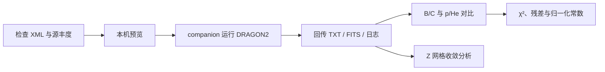

# dragon_project

面向宇宙线传播研究的 DRAGON2 工作流仓库。项目围绕空间依赖扩散指数的 3D DRAGON2 模型，组织输入配置、单轮远端计算、结果回传、AMS-02 对比、p/He 通量归一化拟合以及 Z 网格收敛分析。

本仓库主要保存 Python 工具和工作流代码，**不包含 DRAGON2 源码或可执行文件，也不版本化实验数据、模拟输出、日志和生成图片**。

## 工作流概览



当前推荐入口包括：

- `scripts/run_companion.py`：一次模拟、回传、校验及 B/C、p/He 绘图。
- `dragon_utils/plotting/BCfitting.py`：DRAGON2 B/C 与 AMS-02 的 TOA 诊断对比。
- `dragon_utils/plotting/pHefitting27.py`：质子、氦和等刚度 p/He 对比，可选通量归一化拟合。
- `scripts/zgrid_convergence.py`：基于已有 TXT 的离线 Z 网格收敛比较。
- `dragon_utils/xml_manager/`：XML 参数读取和修改接口。

`dragon_utils/prop/` 保留贝叶斯优化、梯度下降、Markov Chain、神经网络等研究原型。其中部分代码仍依赖历史路径或外部环境，不应替代上述推荐入口。

## 环境要求

基础分析环境：

- Python 3.10+
- NumPy
- SciPy
- Matplotlib
- lxml
- Astropy（FITS 校验和 companion 工作流）

companion 工作流另外需要：

- 可用的 DRAGON2 程序及运行依赖
- SSH、rsync、tmux
- 已配置的 companion 主机与远端路径
- 远端 Python 3.9+

仓库目前不是可直接安装的 Python package，建议从项目根目录运行脚本：

```bash
cd /path/to/dragon_project
python3 -m venv .venv
source .venv/bin/activate
python3 -m pip install numpy scipy matplotlib lxml astropy
```

运行前需要自行准备以下本地目录和数据：

```text
data/experiment_data/   AMS-02 等实验数据
data/processed/         已检查的 XML 与同名 .source.param
data/dragon_output/     DRAGON2 TXT/FITS 输出
outputs/figures/        图片
outputs/csv/            表格
outputs/workflow/       状态、哈希和任务记录
logs/                   命令与运行日志
```

这些目录已在 `.gitignore` 中排除，不会随 Git clone 自动获得。

## 快速使用

### 1. 使用已有 DRAGON2 TXT 绘图

B/C：

```bash
python3 dragon_utils/plotting/BCfitting.py \
    data/dragon_output/model.txt \
    --output outputs/figures/YYYY-MM-DD_BC.png
```

p/He 诊断图：

```bash
python3 dragon_utils/plotting/pHefitting27.py \
    data/dragon_output/model.txt \
    --output outputs/figures/YYYY-MM-DD_pHe.png
```

p/He 通量归一化拟合：

```bash
python3 dragon_utils/plotting/pHefitting27.py \
    data/dragon_output/model.txt \
    --fit \
    --output outputs/figures/YYYY-MM-DD_pHefit.png
```

当前 p/He 拟合默认使用刚度中心 `R >= 10 GV` 的 AMS-02 点，三个面板只显示 `R > 5 GV`。`--fit-min <GV>` 可以修改拟合阈值。质子和氦分别拟合正的后处理常数 `C_p`、`C_He`；这些常数不会修改 XML、源丰度或传播参数。

### 2. 预览并运行一轮 companion 计算

先检查 XML，再执行无写入预览：

```bash
python3 scripts/run_companion.py run /absolute/path/model.xml --preview
```

确认计划、DimZ、源丰度来源和输出清单后再启动：

```bash
python3 scripts/run_companion.py run /absolute/path/model.xml
```

入口会规范化本轮 XML 和源丰度文件名，上传到 companion，运行一次 DRAGON2，回传所启用的 TXT/FITS 和日志，并生成 B/C 与 p/He 两张诊断图。它不会自动修改物理参数或继续提交下一轮。

SSH 中断后不要盲目重跑。使用本轮主体查询和恢复：

```bash
python3 scripts/run_companion.py fetch YYYY-MM-DD_dimZ81
python3 scripts/run_companion.py plot YYYY-MM-DD_dimZ81
```

首次查看实时远端日志：

```bash
tmux attach -t dragon_log
```

### 3. 分析 Z 网格收敛

```bash
python3 scripts/zgrid_convergence.py \
    --input data/dragon_output/ \
    --output outputs/csv/zgrid_convergence.csv \
    --points 200
```

该脚本只读取已有 TXT，不运行 DRAGON2。它比较相邻 DimZ 以及最大 DimZ 参考下的 B/C、质子和总氦最大相对差异，不自动给出收敛判定。

## 物理与统计口径

- DRAGON2 ASCII 谱被视为未调制 LIS，AMS-02 数据被视为 TOA。
- 太阳调制复用 `dragon_utils.data_processing.physics.SM_output`，默认质子、氦和当前 B/C 绘图势均为 0.64 GV。
- 质子通量为 `Sec_p + Pri_p`。
- He-3 和 He-4 分别调制并分别转换为刚度通量，之后再求和。
- 默认对角卡方为 `chi2 = sum(((observed-model)/sigma)^2)`，其中 `sigma = sqrt(stat^2+syst^2)`；总系统误差不与其分项重复相加。
- p/He 的 `C_p`、`C_He` 是现有 TOA 输出的整体乘法常数，不应解释为重新拟合的源丰度。
- 固定 force-field 势、几何能箱中心和对角误差近似均有局限；低能区和相关系统误差需要单独评估。

## 目录结构

| 路径 | 用途 |
| --- | --- |
| `scripts/` | 单轮 companion、XML 批量准备和 Z 网格分析入口 |
| `dragon_utils/data_processing/` | 插值、太阳调制、卡方和通量常数拟合 |
| `dragon_utils/plotting/` | B/C、质子、氦与 p/He 绘图 |
| `dragon_utils/xml_manager/` | XML 参数映射、读取和修改 |
| `dragon_utils/dragonio/` | DRAGON 数据读取工具 |
| `dragon_utils/prop/` | 优化、代理模型和历史研究原型 |
| `data/processed/` | 规范 XML 和 `.source.param` |
| `data/dragon_output/` | DRAGON2 TXT 与 FITS |
| `data/experiment_data/` | 本地实验数据 |
| `outputs/figures/` | 正式图片 |
| `outputs/csv/` | CSV 结果 |
| `outputs/workflow/` | 状态、哈希和运行清单 |
| `logs/` | 命令及 DRAGON2 日志 |
| `docs/` | 任务 prompts、notes 和研究记录 |

## 输出与可复现性

companion 单轮主体使用 `YYYY-MM-DD_dimZ<N>`，日期按 Asia/Tokyo 固定。典型产物为：

```text
data/processed/<stem>.xml
data/processed/<stem>.source.param
data/dragon_output/<stem>.txt
data/dragon_output/<stem>.fits.gz
data/dragon_output/<stem>-spectrum.fits.gz
outputs/figures/YYYY-MM-DD_BCratio_dimZ<N>.png
outputs/figures/YYYY-MM-DD_pHe_dimZ<N>.png
outputs/workflow/<stem>.json
logs/YYYY-MM-DD_HH-MM-SS.md
```

工作流使用退出码、输出清单、文件长度和 SHA256 判定完成状态。DRAGON2 或传输失败不会使用旧输出代替本轮结果。实验 χ² 的改善也不等同于空间网格已经收敛。

## 更多文档

- [项目规则与入口说明](AGENTS.md)
- [研究目标与任务表](tasks_cn.md)
- [脚本详细说明](scripts/README.md)
- [绘图与拟合说明](dragon_utils/plotting/readme.md)
- [数据处理接口](dragon_utils/data_processing/README.md)
- [XML 工具](dragon_utils/xml_manager/README.md)
- [传播与优化原型](dragon_utils/prop/README.md)

这是研究代码仓库。运行新的 DRAGON2 模型前应人工检查 XML、源丰度、核素范围、输出开关和数值设置，并保留对应输入、日志与哈希记录。
