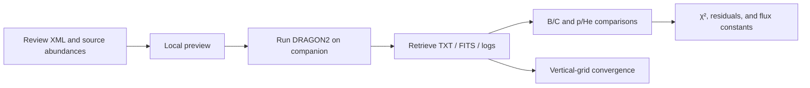

# dragon_project

[English](README.md) | [中文](README_cn.md)

A DRAGON2 workflow repository for cosmic-ray propagation research. The project organizes input configuration, single-run remote execution, result retrieval, AMS-02 comparisons, p/He flux-normalization fitting, and vertical-grid convergence analysis for a 3D DRAGON2 model with a spatially dependent diffusion index.

This repository primarily contains Python utilities and workflow code. It **does not include the DRAGON2 source code or executable, and it does not version experimental data, simulation outputs, logs, or generated figures**.

## Workflow overview



Recommended entry points:

- `scripts/run_companion.py`: run one simulation, retrieve and validate its results, and generate B/C and p/He figures.
- `dragon_utils/plotting/BCfitting.py`: diagnostic TOA comparison of DRAGON2 B/C with AMS-02.
- `dragon_utils/plotting/pHefitting27.py`: proton, helium, and equal-rigidity p/He comparison with optional flux-normalization fitting.
- `scripts/zgrid_convergence.py`: offline vertical-grid convergence analysis using existing TXT spectra.
- `dragon_utils/xml_manager/`: XML parameter reading and modification interfaces.

`dragon_utils/prop/BayesianOptimization/BayesOpt.py` is the active synchronous companion/yellowgiant four-parameter search entry point; its directory README documents the required bounds, Z=8 to Z=14 correction, outputs, and test mode. The other `dragon_utils/prop/` areas remain research prototypes that may depend on historical paths or external environments.

## Requirements

Base analysis environment:

- Python 3.10+
- NumPy, SciPy, Matplotlib, and lxml
- Astropy for FITS validation and the companion workflow

The companion workflow additionally requires a working DRAGON2 executable, SSH, rsync, tmux, configured remote paths, and Python 3.9+ on the remote host.

The repository is not currently packaged for direct installation. Run scripts from the project root:

```bash
cd /path/to/dragon_project
python3 -m venv .venv
source .venv/bin/activate
python3 -m pip install numpy scipy matplotlib lxml astropy
```

Prepare the following local directories and data before running the workflows:

```text
data/experiment_data/   AMS-02 and other experimental data
data/processed/         Reviewed XML files and matching .source.param files
data/dragon_output/     DRAGON2 TXT/FITS outputs
outputs/figures/        Figures
outputs/csv/            Tables
outputs/workflow/       State, hashes, and run records
logs/                   Command and DRAGON2 logs
```

These directories are excluded by `.gitignore` and are not created or populated by cloning the repository.

## Quick start

### Plot an existing DRAGON2 TXT spectrum

```bash
# B/C
python3 dragon_utils/plotting/BCfitting.py \
    data/dragon_output/model.txt \
    --output outputs/figures/YYYY-MM-DD_BC.png

# p/He diagnostic figure
python3 dragon_utils/plotting/pHefitting27.py \
    data/dragon_output/model.txt \
    --output outputs/figures/YYYY-MM-DD_pHe.png

# p/He flux-normalization fit
python3 dragon_utils/plotting/pHefitting27.py \
    data/dragon_output/model.txt \
    --fit \
    --output outputs/figures/YYYY-MM-DD_pHefit.png
```

The current p/He fit uses AMS-02 points with rigidity-bin centers `R >= 10 GV` by default, while all three panels display only `R > 5 GV`. Use `--fit-min <GV>` to change the fit threshold. Positive post-processing constants `C_p` and `C_He` are fitted independently for proton and helium; they do not modify the XML, source abundances, or propagation parameters.

### Preview and run one companion calculation

Review the XML first, then run a no-write preview:

```bash
python3 scripts/run_companion.py run /absolute/path/model.xml --preview
```

After confirming the plan, DimZ, source-abundance origin, and expected outputs, start the run:

```bash
python3 scripts/run_companion.py run /absolute/path/model.xml
```

The entry point gives the XML and source-abundance file canonical names, uploads them to the companion host, runs DRAGON2 once, retrieves enabled TXT/FITS outputs and logs, and creates B/C and p/He diagnostic figures. It does not change physical parameters or submit another run automatically.

Do not blindly rerun after an SSH interruption. Query and recover the same run by its stem:

```bash
python3 scripts/run_companion.py fetch YYYY-MM-DD_dimZ81
python3 scripts/run_companion.py plot YYYY-MM-DD_dimZ81
tmux attach -t dragon_log
```

### Analyze vertical-grid convergence

```bash
python3 scripts/zgrid_convergence.py \
    --input data/dragon_output/ \
    --output outputs/csv/zgrid_convergence.csv \
    --points 200
```

This script reads existing TXT spectra and does not run DRAGON2. It compares the maximum relative differences in B/C, proton flux, and total helium flux between adjacent DimZ values and against the largest-DimZ reference. It does not make an automatic convergence decision.

## Physics and statistics conventions

- DRAGON2 ASCII spectra are treated as unmodulated local interstellar spectra, while AMS-02 data are treated as top-of-atmosphere observations.
- Solar modulation reuses `dragon_utils.data_processing.physics.SM_output`. The current plotting potentials for proton, helium, and B/C are 0.64 GV.
- Proton flux is `Sec_p + Pri_p`; He-3 and He-4 are modulated and converted to rigidity flux separately before summation.
- The default diagonal statistic is `chi2 = sum(((observed-model)/sigma)^2)`, with `sigma = sqrt(stat^2+syst^2)`. The total systematic uncertainty is not added again to its components.
- The p/He constants `C_p` and `C_He` multiply existing TOA outputs and must not be interpreted as newly fitted source abundances.
- Fixed force-field potentials, geometric bin centers, and diagonal uncertainties are approximations. Low-energy behavior and correlated systematics require separate assessment.

## Repository layout

| Path | Purpose |
| --- | --- |
| `scripts/` | Companion run, XML batch preparation, and vertical-grid analysis entry points |
| `dragon_utils/data_processing/` | Interpolation, solar modulation, chi-square, and flux-constant fitting |
| `dragon_utils/plotting/` | B/C, proton, helium, and p/He plotting |
| `dragon_utils/xml_manager/` | XML parameter mapping, reading, and modification |
| `dragon_utils/dragonio/` | DRAGON data readers |
| `dragon_utils/prop/` | Optimization, surrogate-model, and historical research prototypes |
| `data/processed/` | Canonical XML and `.source.param` inputs |
| `data/dragon_output/` | DRAGON2 TXT and FITS outputs |
| `data/experiment_data/` | Local experimental data |
| `outputs/` | Figures, CSV results, state, and run manifests |
| `logs/` | Command and DRAGON2 logs |
| `docs/` | Task prompts, notes, and research records |

## Outputs and reproducibility

A companion run uses the stem `YYYY-MM-DD_dimZ<N>`, with the date fixed in the Asia/Tokyo time zone. Typical products are:

```text
data/processed/<stem>.xml
data/processed/<stem>.source.param
data/dragon_output/<stem>.txt
data/dragon_output/<stem>.fits.gz
data/dragon_output/<stem>-spectrum.fits.gz
outputs/figures/YYYY-MM-DD_BCratio_dimZ<N>.png
outputs/figures/YYYY-MM-DD_pHe_dimZ<N>.png
outputs/workflow/<stem>.json
logs/YYYY-MM-DD_HH-MM-SS.md
```

The workflow uses process exit codes, expected-output manifests, file sizes, and SHA256 hashes to determine completion. A failed DRAGON2 run or transfer does not substitute an older result for the current run. An improved experimental chi-square also does not establish numerical grid convergence.

## Further documentation

- [Project rules and entry points](AGENTS.md)
- [Research goals and task table, Chinese](tasks_cn.md)
- [Research goals and task table, English](tasks_en.md)
- [Script documentation](scripts/README.md)
- [Plotting and fitting](dragon_utils/plotting/readme.md)
- [Data-processing interfaces](dragon_utils/data_processing/README.md)
- [XML utilities](dragon_utils/xml_manager/README.md)
- [Propagation and optimization prototypes](dragon_utils/prop/README.md)

This is a research-code repository. Before starting a new DRAGON2 model, review the XML, source abundances, nuclear-chain range, output switches, and numerical settings, and retain the corresponding inputs, logs, and hashes.
